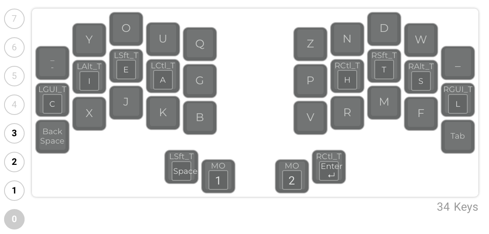

# 35-Engram
A modified key layout based on Engram for 3x5 (40%) split keyboards

- https://github.com/binarybottle/engram-2021
### Engram2

### Engram-en

# Alphabet layer

# Numeric layer

# Symbol layer

# Media layer

