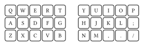
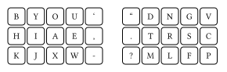
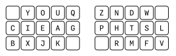
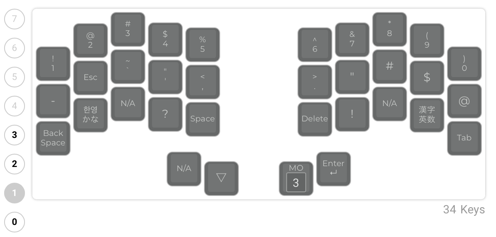
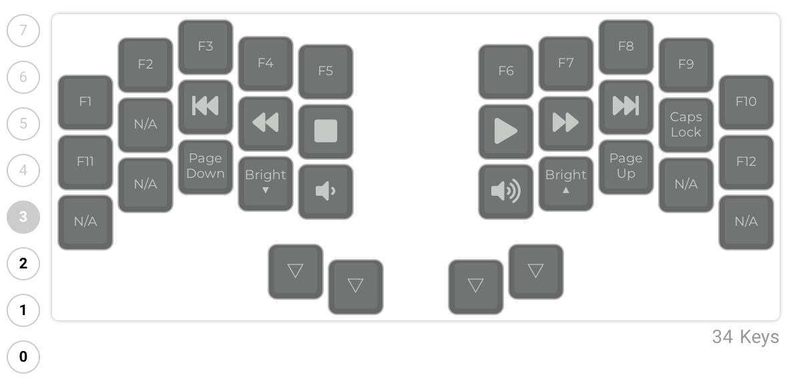

# 35Engram-code
A modified key layout based on Engram for programming on 3x5 (40%) split keyboards.

# Why a new layout?

Assume we use 3x5 (40%) split keyboards.

Everyone knows that the traditional ASCII layout is not ergonomic.

Many new layouts have been proposed. An interesting one is [Engram2]() proposed by (author).
However, it does not work for our keyboards because it has no `q` or `z`.

In 2025, the layout was revised as `Engram-us` (and `Engram-es`) based on new evaluation functions.
But it still has no `q` or `z`.

Therefore we need to create a new layout based on them.
- since I have used Engram2 for a while, most keys are in the same positions.
- but I like placing `n` on the index finger.
- some keys in the symbol columns must be replaced with `q` and `z`.
- and using the pinky fingers so much is uncomfortable.

So let's change some key positions
- Move `Q` from outer space
- Move `Z` from outer space
- Move `B` to the top left
- Move `G` to the bottom left
- Move `V` to the top left
- Move `P` to the bottom left
- swap `L` and `N`.

I call this generated layout `35Engram` (Engram for 3x5 keyboards).

Since I am a programmer, I replace some symbols with more important keys:
- We need `_`. It is a word-constructing letter, belonging to the same category as the alphabet letters, since it builds identifiers such as `max_value`.
- We need `backspace`. Humans make mistakes.
- We need `TAB`. We can't imagine programming in the 21st century without TAB for code completion.
- There is one more room. How about `-`? It is used in identifiers in some programming languages (e.g., kebab-case), and it starts command-line options.

So here's `35Engram-code`.

# Alphabet layer

# Numeric layer

# Symbol layer

# Media layer

# References

- https://github.com/binarybottle/engram-2021
- https://github.com/binarybottle/engram
