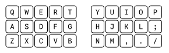
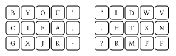
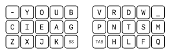
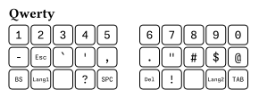
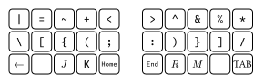
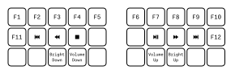

# 35Engram-code
A modified key layout based on Engram for programming on 3x5 (40%) split keyboards.

# Why a new layout?

Assume we use 3x5 (40%) split keyboards.

Everyone knows that the traditional Qwerty layout is not ergonomic.

Many new layouts have been proposed. An interesting one is [Engram2](https://github.com/binarybottle/engram-2021) proposed by Arno Klein.
However, it does not work for our keyboards because it has no `Q` or `Z`.

In 2025, the layout was revised as [`Engram-us`](https://engram-layouts.xyz/engram-en) (and `Engram-es`) based on new evaluation functions.
But it still has no `Q` or `Z`.

Therefore we need to create a new layout based on them.
- since I have used Engram2 for a while, most keys are in the same positions.
- but I like placing `N` on the index finger.
- some keys in the symbol columns must be replaced with `Q` and `Z`.
- and using the pinky fingers so much is uncomfortable.

So let's change some key positions
- Move `Q` from outer space
- Move `Z` from outer space
- Move `B` to the top left to the bottom
- Move `G` to the bottom left to the center column
- Move `V` to the top right to the bottom
- Move `P` to the bottom right to the center column
- swap `L` and `N`.

I call this generated layout `35Engram` (Engram for 3x5 keyboards).

Since I am a programmer, I placed more important keys in the vacant places:
- We need `_`. It is a word-constructing letter, belonging to the same category as the alphabet letters, since it builds identifiers such as `max_value`.
- We need `BACKSPACE`. Humans make mistakes.
- We need `TAB`. We can't imagine programming in the 21st century without TAB for code completion.
- There is one more room. How about `-`? It is used in identifiers in some programming languages (e.g., kebab-case), and it starts command-line options.

So here's `35Engram-code`.

# Numeric layer

# Symbol layer

# Media layer

